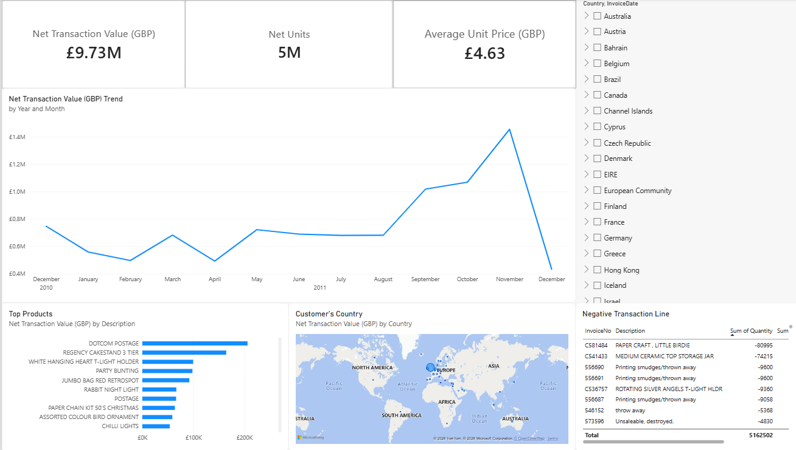

# online-retail-performance-analysis
Repository about analysis financial performance by dataset from: 
Daqing Chen
chend@lsbu.ac.uk
School of Engineering, London South Bank University

# Online Retail Performance Analysis

## Dashboard Preview

## Business Objective

Analyze sales and profitability across products,
markets, and business segments.

## Tools Used

- Microsoft Power BI
- Power Query
- DAX

## Key Findings

- Trends were generally volatile from December 2010 to May 2011, followed by an upward trend between August and November 2011, before a sharp decline at the end of December 2011.
- The "Dotcom Postage" and "Regency Cakestand 3 Tier" products were the dominant items, each generating over £200,000 in transactions, followed by three other products that reached up to £100,000 in transactions.
- The largest share of transactions originated from the United Kingdom—the country from which the data was sourced—totaling £8 million.
- Negative quantities were cancel transaction marked by invoiceNO begin with letter C, that most notable for products such as "Paper Craft," "Little Birdie," and "Medium Ceramic Top Storage Jar." The largest negative quantity occurred for the "Paper Craft" and "Little Birdie" items, specifically in December 2011.

## Recommendations

- Patterns worth investigating can be explored by using slicers to filter transactions by country and date. By analyzing these patterns through such filters, the operations and finance teams should be able to evaluate transaction trends and performance for each individual country.

## Files

- Power BI Dashboard
- PDF Report
- DAX Measures
- Data Dictionary

## License

Chen, D. (2015). Online Retail [Dataset]. UCI Machine Learning Repository. https://doi.org/10.24432/C5BW33. Licensed under CC BY 4.0.
